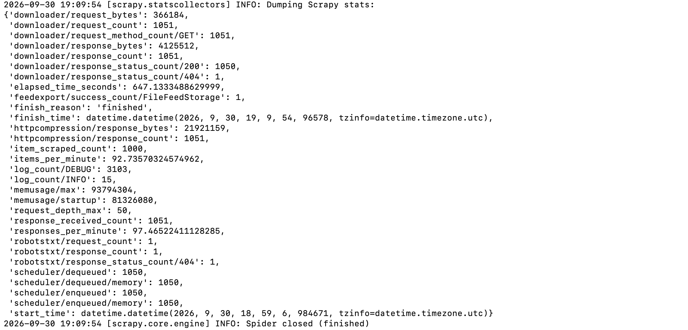
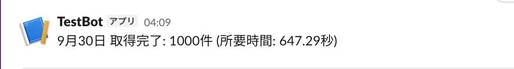

# Books Scraper

Python / Scrapyを使用したWebスクレイピングツールです。

書籍サイトを自動巡回し、タイトル・価格・在庫・評価・URLを取得してCSV / JSONに出力します。

Dockerで実行でき、処理完了時にはSlackへ取得件数と所要時間を通知します。

Docker上でScrapyを実行し、1,000件のデータ取得とCSV出力を確認しています。


## Execution Result

Docker上で実際に実行し、1,000件のデータ取得とCSV出力を確認しています。



処理完了時にはSlackへ自動通知します。




## Features

* Scrapyによる複数ページのスクレイピング
* CSSセレクタ / XPathによるデータ抽出
* データ整形・重複除去
* CSV / JSON出力
* Docker対応
* Slack通知
* robots.txt対応
* AutoThrottleによるアクセス速度調整


## Collected Data

| 項目           | 内容       |
| ------------ | -------- |
| title        | 書籍タイトル   |
| price        | 価格       |
| availability | 在庫状況     |
| rating       | 評価       |
| url          | 詳細ページURL |


## Tech Stack

* Python 3.12
* Scrapy
* ItemAdapter
* Docker
* Slack Incoming Webhook


## Usage

### Docker Build

```bash
docker build -t bookscraper .
```

### CSV Output

```bash
mkdir -p output

docker run --rm \
  --env-file .env \
  -v "$(pwd)/output:/app/output" \
  bookscraper \
  scrapy crawl books -O /app/output/books.csv
```

取得したCSVは `output/books.csv` に保存されます。

### Slack Notification

Slack Webhook URLは `.env` に設定します。

```text
SLACK_WEBHOOK_URL=https://hooks.slack.com/services/...
```

`.env` はGitHubには公開せず、`.gitignore` に追加しています。
実際のWebhook URLはソースコードに記載していません。


## Result

| 項目                 |    結果 |
| ------------------ | ----: |
| Requests           | 1,051 |
| HTTP 200           | 1,050 |
| Scraped Items      | 1,000 |
| Elapsed Time       | 約647秒 |
| CSV Export         |    成功 |
| Slack Notification |    成功 |

## Project Structure

```text
bookscraper/
├── images/
│   ├── scraping-result.png
│   └── slack-notification.png
├── bookscraper/
│   └── spiders/
│       └── books.py
├── Dockerfile
├── requirements.txt
├── scrapy.cfg
├── .gitignore
├── .dockerignore
├── .env.example
└── README.md
```

## Portfolio

Python / Scrapyによるデータ収集だけでなく、データ整形・重複除去・CSV出力・Docker実行・Slack通知までを一連の処理として実装しています。

## Disclaimer

本プロジェクトはスクレイピング技術の学習およびポートフォリオを目的としています。

実際にスクレイピングする際は、対象サイトの利用規約、robots.txt、アクセス頻度、著作権その他の関連ルールを確認してください。
